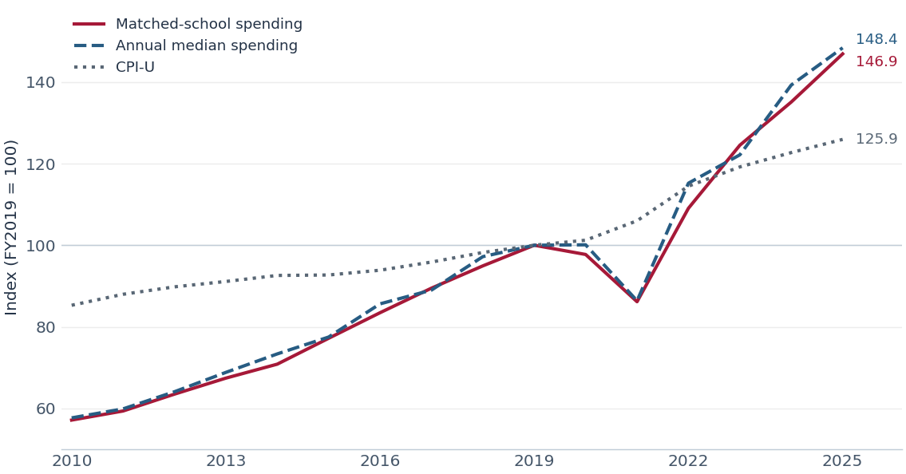

The median Power Four athletics department in this sample spent **$120.2 million in FY2019** and **$178.3 million in FY2025**. That’s **6.8% per year**, compared with **3.9% per year** for U.S. consumer prices. [NCAA/Knight-Newhouse data](https://knightnewhousedata.org/about-the-data) · [BLS annual CPI-U](https://www.bls.gov/regions/northeast/data/consumerpriceindex_us_table.htm)

I wanted a benchmark for a question the dollar figures alone leave open. If a school’s spending grew 6% per year from FY2019 to FY2025, is that unusual? So I took each school's year-over-year spending change, found the median across the same schools in each pair of years, and chained those changes. The result is a **College Athletics Spending Index**. It measures spending growth, which includes changes in prices, staffing, what programs provide, and how schools report it.

The matched-school index grew **6.6% per year** from FY2019 to FY2025, or **2.6% per year after CPI-U**. The rate still rounds to **6.6%** after adding nine ranked public G6 schools. Using EADA for the same 53 Power Four schools gives **6.8% annualized growth**. The annual median was almost unchanged in FY2020 even as the median school-level change was −2.3%. Spending then fell 11.8% in FY2021 and rebounded 26.6% in FY2022 on the matched measure. That swing is part of why I use FY2019 as the starting point for the recent comparison. [Compare the NCAA and EADA benchmarks with CPI-U](../projects/athletics-spending-index.html?chart=view%3D1%26mode%3Dindex%26base%3D2019%26first%3D2019%26last%3D2025%26series%3DTotal%2Bathletics%2Bspending%2Bbenchmark%26series%3DTotal%2Bathletics%2Bexpense%257CSame%2B53%2Breporting%2BPower%2BFour%257CEADA%26series%3DCPI-U%2Bcomparator#explorer)

## How much does each sport account for?

The sport comparisons below use EADA for 68 schools in the Power Four finance cohort, including Notre Dame. That gives us the same schools and definitions across the three sports.

| Sport or reporting bucket | Share of average FY2025 AD budget | Spending CAGR, FY2019–FY2025 |
|---|---:|---:|
| Football | 30.1% | 6.5% |
| Men’s basketball | 9.1% | 5.7% |
| Women’s basketball | 4.2% | 7.2% |
| Other sports | 21.5% | |
| Unallocated to teams | 35.1% | |

Women’s basketball spending grew faster in percentage terms than men’s basketball or football, from a smaller base. Football still made up about three in ten reported athletics dollars. More than a third of all spending sat in EADA’s unallocated bucket, so the sport shares describe what schools assigned to each team in their filings. [Federal EADA data](https://ope.ed.gov/athletics/) · [Budget weights](../assets/finance/escalation/budget_weights_fy2025.csv)

## What does an athletics department spend it on?

This is a separate cut of the budget. It uses the 53 NCAA/Knight-Newhouse schools in the headline index and groups their spending by what it paid for.

| NCAA/Knight-Newhouse category | Share of average FY2025 AD budget | Spending CAGR, FY2019–FY2025 |
|---|---:|---:|
| Facilities, debt and equipment | 21.6% | 4.5% |
| Coaches’ compensation | 19.3% | 6.4% |
| Non-coaching staff compensation | 16.9% | 6.1% |
| Athlete scholarships and related support | 12.9% | |
| Game expenses and travel | 11.6% | |
| Remaining categories combined | 17.5% | |

Coaches and other staff together account for **36.3%** of the average department’s spending. Both compensation series grew faster than CPI-U over this period. Facilities, debt and equipment was the largest single category, but grew **0.6% per year after CPI-U**. Spending on that line can move with the timing of major projects, so I’d use it as a budget benchmark across years. The FY2025 athlete-support grouping changed, and the archive has limited earlier travel detail. Those rows have FY2025 weights and need more work before we can compare their growth over time. [Knight-Newhouse reporting definitions](https://knightnewhousedata.org/about-the-data) · [Full category table](../projects/athletics-spending-index.qmd#budget-weights)

## What changes when the budget weights are held fixed?

The fixed-weight composite grew **5.7% per year** from FY2019 to FY2025, compared with **6.6%** for the headline index. For the composite, I give coaching pay, other staff pay, facilities, and the rest of the budget their FY2025 shares throughout the series. For the headline, I calculate growth in each school’s reported total and take the median each year. Taking medians within expense categories and weighting them can give a different result from taking the median of total growth. The 0.9 percentage point annual gap reflects both the weights and how the two benchmarks aggregate spending.

Both benchmarks reflect changes in what schools spend, including shifts in staffing, program scope, and reporting. An athletics price index would also need independent measures of what it costs to buy the same labor, travel, equipment, and facilities over time.

[Research and downloads](../projects/athletics-spending-index.qmd) · [Athletics Financials dashboard](../projects/finance.qmd)
