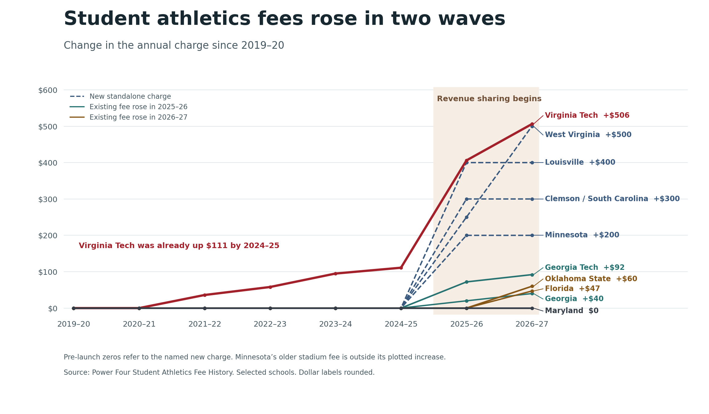

Athletics departments are usually discussed in terms of media rights, ticket sales, and donor support. Some schools also charge students a **mandatory athletics fee**, whether or not those students attend games.

I assembled published fee schedules for the 68 schools in the current Power Four. The comparison is harder than it sounds: some institutions have a distinct athletics line item, others bundle athletics into broader campus fees, and some have no separately verifiable charge.

## Published annual charges

| School | Annual fee | Rate year | Status |
|---|---:|---|---|
| Virginia Tech | $832 | 2026–27 | Published rate |
| Virginia | $823 | 2026–27 | Published rate |
| West Virginia | $500 | 2026–27 | Published rate |
| UCF | $430 | 2026–27 | Published rate |
| Louisville | $400 | 2026–27 | Published rate |
| Maryland | $399 | 2026–27 | Published rate |
| Miami | $360 | 2026–27 | Published rate |
| Georgia Tech | $346 | 2026–27 | Published rate |
| Clemson | $300 | 2026–27 | Published rate |
| South Carolina | $300 | 2026–27 | Published rate |
| North Carolina | $279 | 2026–27 | Published rate |
| Florida State | $237 | 2026–27 | Published rate |
| Illinois | $250 | 2026–27 | Identified facilities and arena allocations |
| Auburn | $232 | 2026–27 | Published rate |
| NC State | $232 | 2026–27 | Published rate |
| Oklahoma State | $225 | 2026–27 | Published rate |
| Minnesota | $212 | 2026–27 | Published rate |
| Arizona State | $200 | Current schedule, year unspecified | Current published rate |
| Colorado | $57–$180 | 2026–27 | Varies by entry cohort |
| Utah | $165 | 2026–27 | Published rate |
| Georgia | $146 | 2026–27 | Published rate |
| Texas Tech | $129 | 2026–27 | Published rate |
| Florida | $104 | 2026–27 | Published rate |
| Houston | $90 | 2026–27 | Identified facilities allocation |
| Northwestern | $72 | 2026–27 | Published rate |
| Kansas State | $0 | 2025–26 | Explicit zero |
| Michigan | $0 | Current schedule, year unspecified | Explicit zero |
| Nebraska | $0 | 2025–26 | Explicit zero |
| Ohio State | $0 | Current schedule, year unspecified | Explicit zero |

```{=html}
<div class="mini-bars" role="img" aria-label="Selected annual athletics fees: Virginia Tech 832 dollars, Virginia 823 dollars, Maryland 399 dollars, NC State 232 dollars">
  <div class="mini-bar-row"><b>Virginia Tech</b><div class="mini-bar-track"><span style="width:100%"></span></div><strong>$832</strong></div>
  <div class="mini-bar-row"><b>Virginia</b><div class="mini-bar-track"><span style="width:98.9%"></span></div><strong>$823</strong></div>
  <div class="mini-bar-row"><b>Maryland</b><div class="mini-bar-track"><span style="width:48%"></span></div><strong>$399</strong></div>
  <div class="mini-bar-row"><b>NC State</b><div class="mini-bar-track"><span style="width:27.9%"></span></div><strong>$232</strong></div>
</div>
```

## When fees started rising

Eight of the nine schools with comparable published fees in 2019–20, 2024–25, and both years since charged the same amount in 2019–20 and 2024–25. Six raised them over the next two years. The median school added **$40 per student per year**, while the average increase was **$84**, or **$45** without Virginia Tech.



Virginia Tech was already up **$111** by 2024–25, then added another **$395** over two years. Georgia and Georgia Tech raised existing fees in 2025–26, the first year of athlete revenue sharing. Florida and Oklahoma State followed in 2026–27. Maryland stayed at **$399 per year**.

The chart also includes schools that introduced a standalone charge. Clemson and South Carolina added **$300** each in 2025–26, Louisville added **$400**, and Minnesota added a **$200** facilities fee. West Virginia introduced its **$250** fee in 2025–26 and doubled it the following year. The pre-launch zeros represent those specific charges.

The timing lines up with new pressure on athletics budgets. [Minnesota’s FY2026 budget](https://regents.umn.edu/sites/regents.umn.edu/files/2025-06/docket-bor-jun182025.pdf) identifies $22.5 million in settlement-related costs and lists the new facilities fee among its responses. [Georgia Tech’s fee request](https://www.budgets.gatech.edu/File?F=MSFAC%2F26MSFAC+AthleticAssoc-Fee+Request+Workbook.pdf) cites lost ACC revenue related to NIL. [Virginia Tech’s budget](https://www.bov.vt.edu/assets/Materials-March%2024-25%2C%202025-35.pdf) attributes $188 of its first $295 increase to moving costs from other student fee categories. The fee changes show what happened to student bills. The budget documents explain why the increases differed by school.

## Compare fees and tickets

[Open the student athletics costs dashboard](../assets/articles/student-fee-dashboard/index.html) to compare all 68 schools. Expand a school to see its mandatory fee, enrollment assumptions for estimates, and ticket options. A paid season package can coexist with a free single-game lottery, as it does at Virginia Tech.

## Coverage

| Conference | Schools | Positive rate | Explicit zero | Unquantified |
|---|---:|---:|---:|---:|
| ACC | 18 | 9 | 0 | 9 |
| Big 12 | 16 | 8 | 1 | 7 |
| Big Ten | 18 | 4 | 3 | 11 |
| SEC | 16 | 4 | 0 | 12 |
| **Total** | **68** | **25** | **4** | **39** |

Of the 29 numerical entries, 24 are explicitly dated 2026–27. Houston and Illinois show identified allocations within broader fees. The Houston amount covers facilities debt, and Illinois includes the multi-use State Farm Center. The table displays whole dollars, with published precision retained in the CSV.

This is a comparison of **what students are charged**, not a complete measure of institutional subsidy. To estimate the latter, we'd also need enrollment, exemptions, allocation rules, and the NCAA's accounting categories for direct institutional support and student fees.

The interesting economic question is not just which schools charge the most. It's how much of an athletics budget is financed through compulsory student payments, and whether those payments are visible to students in the first place.

**Data:** [Power Four fee inventory (CSV)](../assets/articles/p4_mandatory_athletics_fees.csv) · [Athletics financial dashboard](../projects/finance.qmd)

**Method:** Published school fee schedules and associated source links are retained row by row. Annualization assumes standard terms or credit loads where noted. This is a working inventory, not a definitive ranking of total athletics subsidies.
