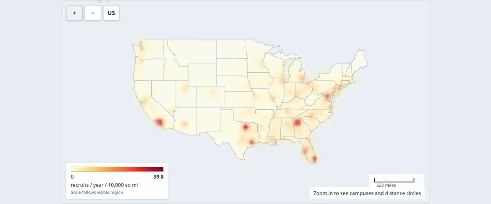
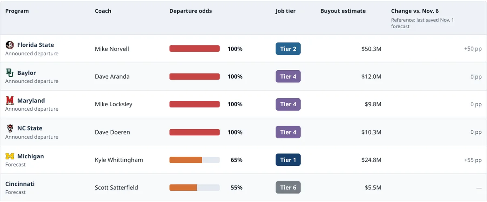
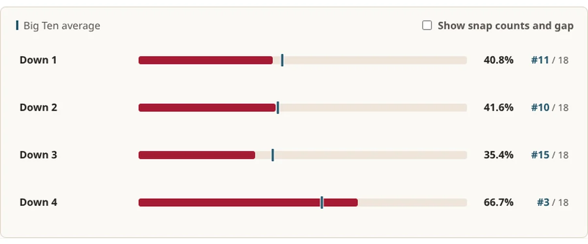
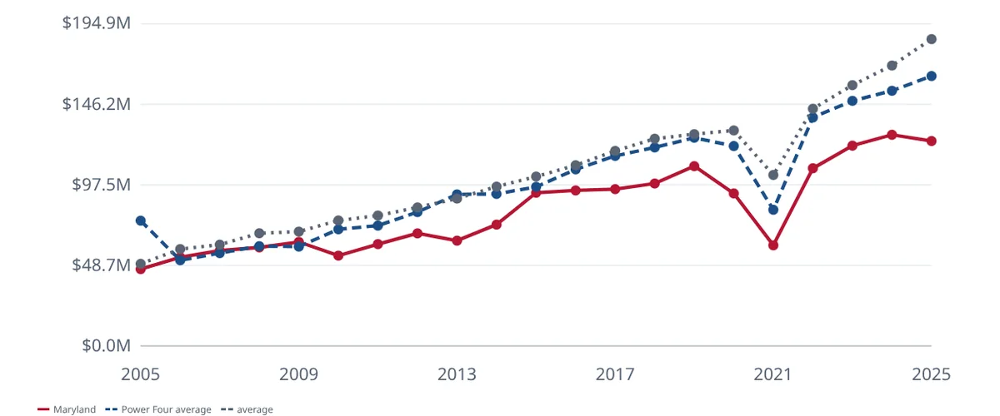

```{=html}
<div class="game-day" id="maryland-game-day" hidden>
  <a class="content-container game-day-link" href="projects/maryland-basketball-live.html">
    <span class="game-day-matchup"></span>
    <span class="game-day-action">Open live dashboard</span>
  </a>
</div>
<script type="module" src="assets/home/game-day.js?v=page1"></script>
```

::: {.content-band .home-preview}
::: {.content-container}
```{=html}
<section class="dashboard-carousel" aria-labelledby="carousel-title" aria-roledescription="carousel">
  <div class="section-heading section-heading-tight">
    <h2 id="carousel-title">Dashboard previews</h2>
    <div class="carousel-controls" hidden>
      <button type="button" class="carousel-rotation" aria-label="Pause automatic scrolling" title="Pause automatic scrolling"><span aria-hidden="true">Ⅱ</span></button>
      <button type="button" data-step="-1" aria-label="Previous dashboard"><span aria-hidden="true">‹</span></button>
      <span class="carousel-position" role="status">1 of 8</span>
      <button type="button" data-step="1" aria-label="Next dashboard"><span aria-hidden="true">›</span></button>
    </div>
  </div>
  <ul class="carousel-track" aria-label="Dashboard previews">
    <li><a href="projects/recruiting.html"><strong>Recruiting Geography</strong><span>DMV recruiting heat map and 100-mile campus circles</span></a></li>
    <li><a href="projects/program-rankings.html"><strong>FBS Program Rankings</strong><span>The top-ranked head-coaching jobs</span></a></li>
    <li><a href="projects/coaching.html"><strong>2026 Coaching Carousel</strong><span>Departure odds and reported buyouts</span></a></li>
    <li><a href="projects/championships.html"><strong>Big Ten Championships</strong><span>Big Ten titles by school</span></a></li>
    <li><a href="projects/football-success.html"><strong>Big Ten Football Success Rates</strong><span>Maryland’s 2026 offensive success by down</span></a></li>
    <li><a href="projects/officiating.html"><strong>Basketball Officiating</strong><span>Maryland’s foul mix vs. conference peers</span></a></li>
    <li><a href="projects/finance.html"><strong>Athletics Financials</strong><span>School spending and peer benchmarks</span></a></li>
    <li><a href="projects/athletics-spending-index.html"><strong>College Athletics Spending Index</strong><span>Athletics spending growth, FY2016–FY2025</span></a></li>
  </ul>
</section>
<script src="assets/home/carousel.js" defer></script>
```
:::
:::

::: {.landing-hero}
::: {.hero-inner}
::: {.hero-copy}
# At the intersection of sports, data, and money.

:::

::: {.hero-art}

:::
:::
:::

::: {.content-band .first-band}
::: {.content-container}
<div class="section-heading section-heading-tight">
<h2 id="explore">Explore</h2>
<a class="section-link" href="projects/index.html">All dashboards</a>
</div>

<nav class="home-dashboard-links" id="home-dashboard-links" aria-label="Dashboards" hidden></nav>
<nav class="home-categories" aria-label="Dashboard categories">
  <a href="projects/index.html#football">Football</a>
  <a href="projects/index.html#basketball">Basketball</a>
  <a href="projects/index.html#college-athletics">College Athletics</a>
</nav>
:::
:::

::: {.content-band .last-band}
::: {.content-container}
<div class="section-heading section-heading-tight">
<h2>From the articles</h2>
<a class="section-link" href="articles/index.html">All articles</a>
</div>

<a class="article-teaser" href="articles/college-athletics-spending-index.html"><div><h3>How Fast Is College Athletics Spending Growing?</h3><p>Spending growth by sport and the breakdown of an athletics budget.</p></div></a>
<a class="article-teaser" href="articles/recruiting-distance.html"><div><h3>How Far Do Blue-Chip Recruits Travel?</h3><p>Distance distributions and the Maryland recruiting market.</p></div></a>
<a class="article-teaser" href="articles/down-14-two-point-conversions.html"><div><h3>Down 14: The 2PA Strategy: Game Theory and Football</h3><p>Fourth-quarter decisions in the NFL and FBS.</p></div></a>

:::
:::
