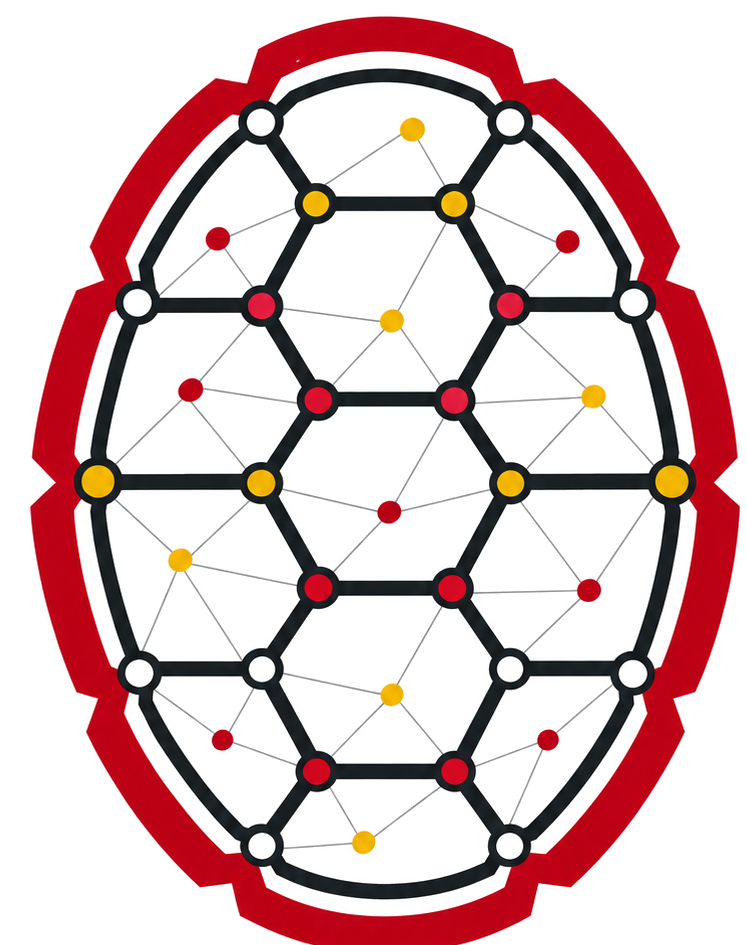

::: {.landing-hero .landing-hero-compact}
::: {.hero-inner}
::: {.hero-copy}

 TERRAPINALYTICS

# College sports research and dashboards

<ul class="topic-list">
<li><a href="projects/recruiting.html">Recruiting Geography</a></li>
<li><a href="projects/program-rankings.html">FBS Program Rankings</a></li>
<li><a href="projects/coaching.html">Coaching Carousel</a></li>
<li><a href="projects/officiating.html">Officiating Lab</a></li>
<li><a href="projects/championships.html">Big Ten Championship Tracker</a></li>
</ul>

<a class="btn-main" href="projects/index.html">View research</a><a class="btn-quiet" href="articles/index.html">Articles</a>

:::

::: {.hero-art}

:::
:::
:::

::: {.content-band .first-band}
::: {.content-container}

Research
<h2>Projects</h2>

::: {.project-grid}
<a class="project-card" href="projects/recruiting.html">
Football
<h3>Recruiting Geography</h3>
Distance, local competition, and blue-chip recruiting patterns.
</a>
<a class="project-card" href="projects/program-rankings.html">
Football
<h3>FBS Program Rankings</h3>
79 coaching jobs, program resources, performance, and supporting data.
</a>
<a class="project-card" href="projects/coaching.html">
Football
<h3>Coaching Carousel</h3>
Departure odds, job tiers, buyout estimates, and reporting.
</a>
<a class="project-card" href="projects/officiating.html">
Basketball
<h3>Officiating Lab</h3>
Foul rates, referee tendencies, and whistle profiles.
</a>
<a class="project-card" href="projects/championships.html">
Big Ten
<h3>Championship Tracker</h3>
Conference titles by school, sport, and era.
</a>
:::
:::
:::

::: {.content-band .last-band}
::: {.content-container}

Writing
<h2>Articles</h2>
<a class="section-link" href="articles/index.html">All articles</a>

<a class="article-teaser" href="articles/welcome.html">
<h3>Welcome to Terrapinalytics</h3>
Scope, methods, and what will be posted here.

↗</a>
:::
:::
