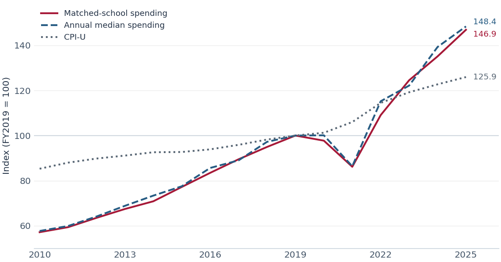

The headline index tracks the median year-over-year change in total athletics expenses across **53 reporting Power Four schools**, with **FY2019 = 100**. It reached **146.9 in FY2025**, compared with **125.9 for CPI-U**. [Read the article](../articles/college-athletics-spending-index.qmd)

[Annual index and benchmark data (CSV)](../assets/finance/escalation/annual_series.csv) · [FY2025 budget weights (CSV)](../assets/finance/escalation/budget_weights_fy2025.csv) · [Reproduction script](https://github.com/terrapinalytics/terrapinalytics.github.io/blob/main/scripts/build-athletics-spending-index.py)

## Annual benchmarks

The download includes the 13 series below, with annual median spending, matched growth, the middle half of school-level growth rates, the number of usable school pairs, and indexes in nominal and CPI-adjusted terms. All changes below are from FY2019 through FY2025. Coverage starts in FY2010 except the facilities, debt and equipment series, which starts in FY2015.

| Spending series | Source and sample | FY2025 matched index | Nominal growth | CPI-U adjusted growth |
|---|---|---:|---:|---:|
| Total athletics expenses | NCAA, 53 reporting Power Four | 146.9 | 46.9% | 16.6% |
| Total athletics expenses | NCAA, 62 ranked publics | 146.8 | 46.8% | 16.6% |
| Total athletics expenses | NCAA, 9 ranked public G6 | 151.3 | 51.3% | 20.2% |
| Total athletics expenses | EADA, same 53 reporting Power Four | 148.6 | 48.6% | 18.0% |
| Total athletics expenses | EADA, all 79 dashboard schools | 150.5 | 50.5% | 19.5% |
| Football expenses | NCAA, reporting Power Four | 142.2 | 42.2% | 12.9% |
| Football expenses | EADA, 68 Power Four including Notre Dame | 145.6 | 45.6% | 15.6% |
| Men’s basketball expenses | EADA, same 68 | 139.6 | 39.6% | 10.9% |
| Women’s basketball expenses | EADA, same 68 | 152.1 | 52.1% | 20.8% |
| Coaches’ compensation | NCAA, 53 reporting Power Four | 145.1 | 45.1% | 15.2% |
| Non-coaching staff compensation | NCAA, same 53 | 142.7 | 42.7% | 13.3% |
| Facilities, debt and equipment | NCAA, same 53 | 130.3 | 30.3% | 3.5% |
| Recruiting expenses, all sports | EADA, 68 Power Four including Notre Dame | 151.9 | 51.9% | 20.6% |

## Budget weights

The **average school share** gives an equal vote to every AD. The **pooled share** divides the sum of category expenses by the sum of total expenses, so larger budgets count more. The figures in each table sum to 100% before rounding. These are two separate views of spending and use different reporting samples.

### NCAA/Knight-Newhouse expense categories

53 reporting Power Four schools, **$9.79 billion in combined FY2025 expenses**. The 12 categories reconcile to total expenses at each school.

| Category | Average school share | Pooled share |
|---|---:|---:|
| Facilities, debt and equipment | 21.63% | 22.02% |
| Coaches’ compensation | 19.33% | 19.07% |
| Non-coaching staff compensation | 16.92% | 16.76% |
| Athlete scholarships and related support | 12.94% | 12.61% |
| Game expenses and travel | 11.63% | 11.63% |
| Other expenses | 10.87% | 11.24% |
| Recruiting | 1.89% | 1.90% |
| Competition guarantees | 1.58% | 1.60% |
| Medical expenses | 1.21% | 1.17% |
| Coaching severance | 1.16% | 1.07% |
| Institutional NIL revenue share | 0.49% | 0.51% |
| Excess transfers back | 0.33% | 0.40% |

The FY2025 scholarship and related support category reflects new reporting definitions. The institutional NIL line reflects the amounts schools carried on their own reports in that fiscal year. Third-party NIL is outside the Knight-Newhouse dataset, and FY2025 ended before implementation of the House settlement. [Knight-Newhouse FAQ](https://knightnewhousedata.org/faq)

### EADA expenses by sport

68 Power Four schools, including Notre Dame, **$11.62 billion in combined FY2025 expenses**. Other sports is the remainder after subtracting football, both basketball teams, and reported unallocated expenses from the school's EADA grand total.

| Sport or reporting bucket | Average school share | Pooled share |
|---|---:|---:|
| Football | 30.09% | 30.06% |
| Men’s basketball | 9.13% | 8.71% |
| Women’s basketball | 4.20% | 4.07% |
| Other sports | 21.53% | 21.41% |
| Unallocated to teams | 35.05% | 35.74% |

## How the index is built

1. For each metric and pair of adjacent fiscal years, calculate the percentage change at every school with a positive usable observation in both years. This keeps blanks, true zeros with undefined percentage growth, and flagged observations out of the link.
2. Take the median of those changes. Set FY2019 to 100 and multiply forward by one plus each annual median change. Divide back through earlier years.
3. Compare it with the annual cross-sectional median spending level, also rebased to FY2019. The annual median-dollar figure describes the middle department each year. The matched calculation describes the median change at the school level.
4. For the real series, divide the matched index by the CPI-U index and multiply by 100. CPI-U uses the U.S. city average for all items and is matched by the year in the fiscal-year label. [BLS annual CPI-U](https://www.bls.gov/regions/northeast/data/consumerpriceindex_us_table.htm)

The headline has 53 usable pairs in every link. NCAA football has 44 links into and out of FY2012 because nine reported zeros were flagged in the financial audit. The G6 series is a benchmark for the nine ranked public G6 programs with NCAA data. It does not represent the entire Group of Six. The archive preserves source distinctions, and NCAA and EADA are calculated as separate series throughout. [Source panel and provenance](../assets/coaching/supporting_data.zip) · [Financial data audit](../assets/coaching/data_quality.md)

The FY2025 budget mix describes where athletics dollars went. To estimate input price inflation separately, a future index would need stable spending weights, independent price measures for the major inputs, and a consistent way to handle athlete compensation and policy changes.
